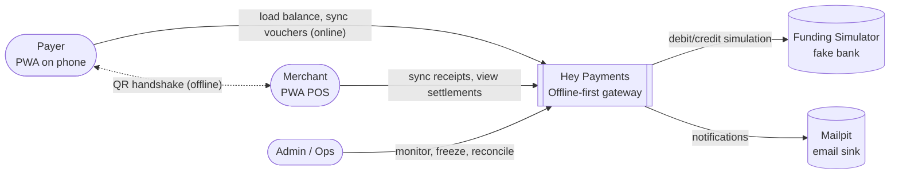
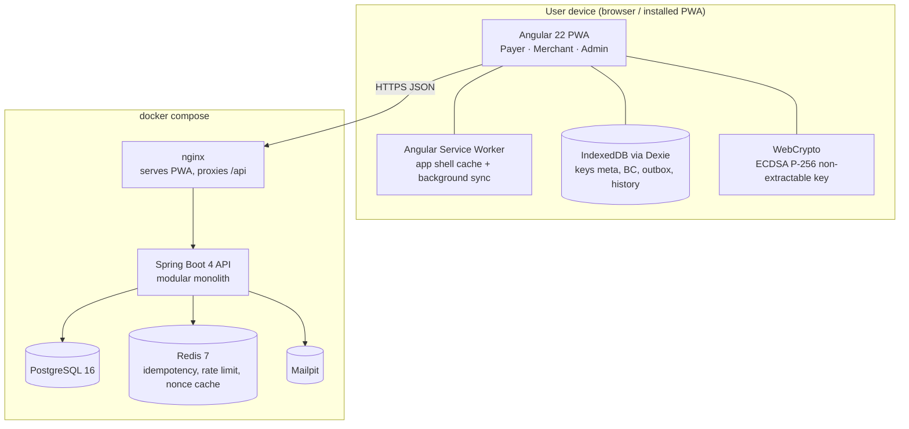
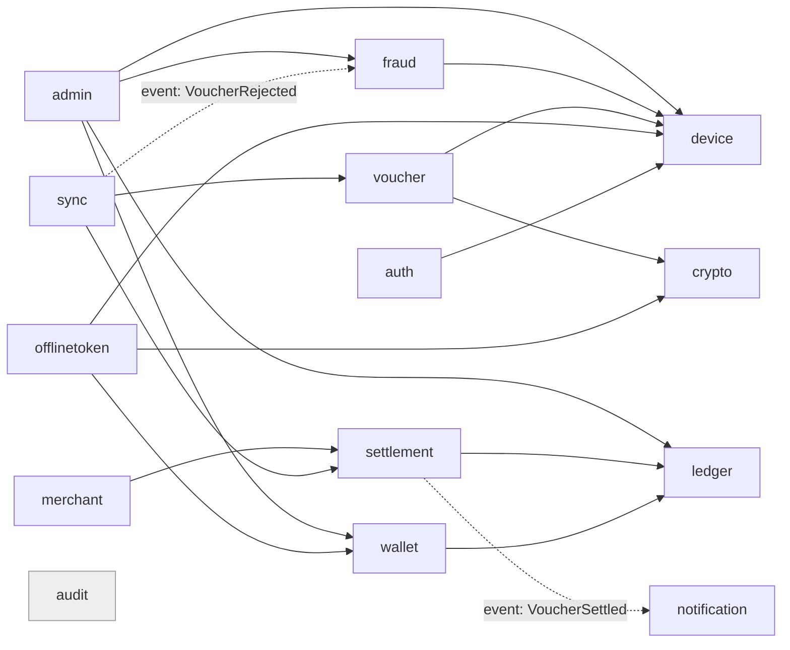
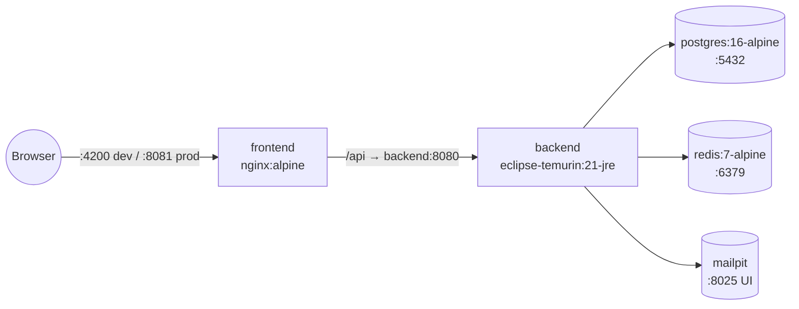

# 02 · System Architecture

## 1. Architectural style
- **Modular monolith** (one Spring Boot deployable) with strict module boundaries, enforced by **Spring Modulith** (`ApplicationModules.verify()`) and **ArchUnit** tests. It is easy to run in Docker, easy to test, and can be split later.
- **Offline-first PWA**: the client is the system of record for offline artefacts until sync; the server is the system of record for money.
- **Event-driven inside the monolith**: modules talk through Spring application events (`@ApplicationModuleListener`) with the Modulith **event publication registry** (transactional outbox) for reliability.

## 2. C4 Level 1: System context


## 3. C4 Level 2: Containers


## 4. C4 Level 3: Backend modules
Package root `com.heypayments`. **Package by feature, not by layer.** The scaffold's `controller/` and `config/` packages move into `shared` / `auth` in Phase 0.



| Module | Responsibility | Owns tables |
|---|---|---|
| `shared` | Error model, `Money` value object, idempotency filter, clock, IDs (UUIDv7) | `idempotency_keys` |
| `crypto` | ECDSA sign/verify, canonical JSON (RFC 8785 JCS), SHA-256, server key management | `server_keys` |
| `auth` | Users, roles, password hashing (Argon2id), JWT access + refresh, OTP simulation | `users`, `refresh_tokens` |
| `device` | Device registration, public keys, status (ACTIVE/FROZEN/REVOKED), CRL | `devices` |
| `wallet` | Main wallet, funding simulator | `wallets` |
| `ledger` | Double-entry accounts and journal; invariants; balance queries | `ledger_accounts`, `journal_entries`, `journal_lines` |
| `offlinetoken` | Load/unload offline balance, issue Balance Certificates | `balance_certificates` |
| `voucher` | Voucher/receipt parsing and full verification rules | `vouchers`, `receipts` |
| `sync` | Batch ingestion, ordering by counter, idempotency, per-voucher results | `sync_batches` |
| `settlement` | Posts settled vouchers to the ledger, merchant settlement reports | `settlements` |
| `merchant` | Merchant profile, merchant device certificate, dashboards | `merchants` |
| `fraud` | Rules (double spend, counter gap, chain break, limits), cases | `fraud_cases` |
| `notification` | In-app + email notifications | `notifications` |
| `admin` | Read models + admin commands | — |
| `audit` | Append-only audit log for every money/security action | `audit_log` |

**Layering inside each module:** `web` (controllers + DTOs) → `application` (use-case services, transactions) → `domain` (entities, value objects, pure rules, *no Spring*) → `infra` (JPA repositories, adapters). Only `application` APIs and published events are visible to other modules; `domain`/`infra` are `internal`.

## 5. Frontend architecture (summary; see [09](09-frontend-architecture.md))
```
src/app/
  core/        auth, http interceptors, crypto, offline store (Dexie), sync engine, connectivity signal
  shared/      design-system components (hp-button, hp-amount, hp-status-pill, hp-qr…), pipes
  features/
    payer/     home, load-offline, scan-pay, receipt, history
    merchant/  pos (request amount), scan-voucher, today, settlements
    admin/     dashboard, users, devices, ledger, fraud
    onboarding/ auth/
```

## 6. Deployment (docker compose)

Details in [11-devops-docker.md](11-devops-docker.md).

## 7. Technology choices and reasons
| Concern | Choice | Why |
|---|---|---|
| Language/runtime | Java 21 LTS | Already in scaffold; records, sealed types, virtual threads |
| Framework | Spring Boot 4.1 (`webmvc`, `validation`, `actuator`, `security`, `data-jpa`, `data-redis`) | Already scaffolded; mature |
| Modularity | Spring Modulith | Enforced boundaries + event outbox |
| DB | PostgreSQL 16 | ACID, `SERIALIZABLE`/row locks for ledger, JSONB for raw payloads |
| Migrations | Flyway | Versioned, reviewable SQL |
| Cache/locks | Redis 7 | Idempotency-key store, rate limiting (Bucket4j), nonce dedupe |
| API docs | springdoc-openapi | Generates Swagger UI; contract source for the frontend client |
| Crypto | JDK `java.security` (SHA256withECDSA, P-256) + Web Crypto on client | No exotic deps, interoperable (signatures in IEEE P1363 r‖s format on both sides) |
| Canonical JSON | RFC 8785 JCS (`erdtman/java-json-canonicalization`, `canonicalize` npm) | Same bytes are signed on client and verified on server |
| Frontend | Angular 22, signals, standalone, `@angular/service-worker` | Already scaffolded; first-class PWA |
| Offline DB | Dexie (IndexedDB) | Transactions, versioned schema |
| QR | `qrcode` (generate), `@zxing/browser` (scan) | Robust, MIT |
| UI kit | Custom design system built from Canva tokens on Angular CDK (a11y, overlay) | Unique look, accessible primitives |
| Tests | JUnit 5, AssertJ, Mockito, Testcontainers, ArchUnit · Vitest, Angular Testing Library · Playwright | TDD at every layer |
| Observability | Actuator, Micrometer, structured JSON logs with correlation id | Debuggable demo |
