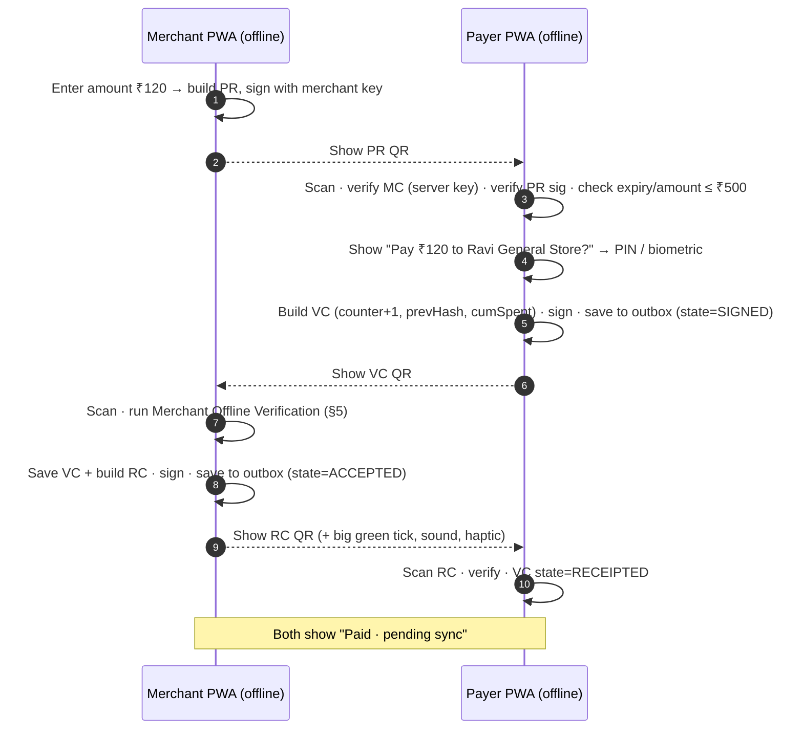

# 03 · Offline Payment Protocol (HP-OFFLINE v1)

> This is the most important document. Every crypto and verification rule here must have a unit test (see [10](10-testing-strategy.md)). The coding agent **must not** change this protocol without a proposal in `docs/proposals/`.

## 1. Design goals
1. A payment works with **zero connectivity on both devices**.
2. The merchant gets **offline-verifiable proof** that the money exists and that the payer authorised it.
3. **No settlement without proof**; **no double settlement** (exactly-once).
4. Cloning a device to double spend is **bounded** (caps), **detectable** (counters + hash chain) and **absorbed** (merchant guarantee from a risk reserve, recovered from the payer).
5. Transport-agnostic: QR in v1; NFC/BLE later with the same messages.

## 2. Keys and trust anchors
| Key | Algorithm | Where it lives | Purpose |
|---|---|---|---|
| **Server signing key** (`kid` rotates every 90 days) | ECDSA P-256 / SHA-256 | Backend (`server_keys` table, private key encrypted with `HP_MASTER_KEY` env; HSM in production) | Signs Balance Certificates and Merchant Certificates |
| **Payer device key** | ECDSA P-256 | Browser WebCrypto, `extractable: false`, `CryptoKey` stored in IndexedDB | Signs Vouchers |
| **Merchant device key** | ECDSA P-256 | Same as above, on the merchant device | Signs Payment Requests and Receipts |

- Clients cache the **server JWKS** (`GET /api/v1/keys/jwks`) and the **CRL** (`GET /api/v1/devices/crl`) whenever they are online. Merchant devices refuse offline acceptance if the CRL is older than **48 h** (UI tells them to go online).
- **Signature format:** IEEE P1363 (`r‖s`, 64 bytes), base64url. This is what WebCrypto produces natively; the Java side uses `SHA256withECDSAinP1363Format`.
- **Canonicalisation:** the signed bytes are `UTF-8(JCS(payload))` (RFC 8785). The signature lives *outside* the payload: `{ "p": <payload>, "s": "<sig>" }`.
- Public keys travel as base64url of the uncompressed SEC1 point (65 bytes) or as a JWK on registration.

## 3. Messages
All amounts are integers in **paise**. All ids are UUIDv7 strings. `v` = protocol version (`1`).

### 3.1 Balance Certificate (BC), issued by the server at load time
```json
{ "p": {
    "v": 1, "t": "BC",
    "bcId": "0193…", "walletId": "0193…", "deviceId": "0193…",
    "devicePub": "BASE64URL_SEC1_POINT",
    "limit": 200000,
    "counterStart": 41,
    "issuedAt": "2026-11-12T10:00:00Z", "expiresAt": "2026-11-16T10:00:00Z",
    "kid": "srv-2026-11"
  },
  "s": "BASE64URL_SIG_BY_SERVER" }
```
- Exactly **one ACTIVE BC per device**. Issuing a new one (top-up) supersedes the old one.
- `limit` = offline funds held in escrow for this device at issuance.
- **Top-up rule:** loading requires the device to have **synced its outbox first** (the server checks `lastCounter` reported by the device = highest counter it has received). New BC: `limit = remaining escrow + topUp`, `counterStart = lastCounter + 1`, and the device's spent-so-far resets to 0 for the new BC.

### 3.2 Merchant Certificate (MC), issued by the server when a merchant device registers
```json
{ "p": { "v":1, "t":"MC", "merchantId":"…", "deviceId":"…", "devicePub":"…",
         "displayName":"Ravi General Store", "vpaLike":"ravi.store@hey",
         "issuedAt":"…", "expiresAt":"…(+30 days)", "kid":"srv-2026-11" },
  "s": "…" }
```

### 3.3 Payment Request (PR), shown by the merchant as a QR
```json
{ "p": { "v":1, "t":"PR", "prId":"…(nonce)", "merchantId":"…", "merchantDeviceId":"…",
         "amount": 12000, "currency":"INR", "note":"2x chai, 1 samosa",
         "createdAt":"…", "expiresAt":"…(+5 min)" },
  "s": "SIG_BY_MERCHANT_DEVICE",
  "mc": { …Merchant Certificate… } }
```

### 3.4 Voucher (VC), created by the payer device and shown as a QR
```json
{ "p": { "v":1, "t":"VC", "voucherId":"…", "bcId":"…", "deviceId":"…",
         "counter": 42, "prevHash":"BASE64URL_SHA256_OF_PREVIOUS_VOUCHER_ENVELOPE | GENESIS(bcId)",
         "prId":"…", "merchantId":"…", "amount":12000, "cumSpent": 12000,
         "createdAt":"…" },
  "s": "SIG_BY_PAYER_DEVICE",
  "bc": { …Balance Certificate… } }
```
- `cumSpent` = total of all vouchers under this BC including this one. It must satisfy `cumSpent ≤ bc.limit`.
- `prevHash` = SHA-256 over JCS of the previous voucher's `{p,s}`. The first voucher under a BC uses `SHA-256("GENESIS:" + bcId)`.
- `counter` is **per device and monotonic forever** (it never resets across BCs).

### 3.5 Receipt (RC), created by the merchant device and shown as a QR to the payer
```json
{ "p": { "v":1, "t":"RC", "voucherId":"…", "voucherHash":"…", "merchantDeviceId":"…",
         "acceptedAt":"…" },
  "s": "SIG_BY_MERCHANT_DEVICE" }
```

### 3.6 Transport encoding
- Envelope → JSON → **DEFLATE (raw)** → **Base45** (RFC 9285, QR alphanumeric-friendly) → prefix `HP1:<TYPE>:`.
- Typical sizes: PR ≈ 550 B, VC+BC ≈ 750 B → QR version ≈ 15–20 at ECC level M.
- If an encoded payload is > 1,800 chars, use **multipart frames** `HP1:VC:2/3:…`, auto-cycled every 300 ms (animated QR); the scanner assembles them.
- **Manual fallback:** a 10-character short code for the receipt only (`voucherHash` prefix), shown for verbal confirmation.

## 4. The offline handshake (happy path)


## 5. Verification rules
### 5.1 Payer checks on a PR (offline)
| # | Rule | Error code |
|---|---|---|
| P1 | MC signature valid under a cached server `kid`, MC not expired | `MC_INVALID` |
| P2 | PR signature valid under `mc.devicePub`; `mc.deviceId == pr.merchantDeviceId` | `PR_SIG_INVALID` |
| P3 | `now ≤ pr.expiresAt` (±10 min skew tolerance) | `PR_EXPIRED` |
| P4 | `1 ≤ amount ≤ perTxnCap` and `amount ≤ bc.limit − spent` | `LIMIT_EXCEEDED` |
| P5 | BC present, not expired, counter budget (`maxVouchersPerBc`) not exhausted | `OFFLINE_BALANCE_UNAVAILABLE` |
| P6 | Merchant device not in cached CRL | `MERCHANT_REVOKED` |

### 5.2 Merchant offline verification of a VC
| # | Rule | Error code |
|---|---|---|
| M1 | Decode and schema-validate envelope (`v==1`, `t=="VC"`) | `MALFORMED` |
| M2 | BC signature valid under a cached server key; `bc.expiresAt + 24h ≥ now` | `BC_INVALID` |
| M3 | `bc.deviceId` not in cached CRL; CRL age ≤ 48 h | `DEVICE_REVOKED` / `CRL_STALE` |
| M4 | VC signature valid under `bc.devicePub`; `vc.deviceId == bc.deviceId`; `vc.bcId == bc.bcId` | `VC_SIG_INVALID` |
| M5 | `vc.prId` equals the merchant's currently open PR; `amount` and `merchantId` match | `PR_MISMATCH` |
| M6 | `vc.counter ≥ bc.counterStart`; `vc.amount ≤ perTxnCap`; `vc.cumSpent ≤ bc.limit`; `vc.cumSpent ≥ vc.amount` | `LIMIT_EXCEEDED` |
| M7 | Local dedupe: `voucherId` unseen **and** `(deviceId, counter)` unseen in the merchant's store | `DUPLICATE` |
| M8 | Merchant's unsynced accepted total + amount ≤ merchant pending cap (₹10,000) | `MERCHANT_SYNC_REQUIRED` |

If all pass, the PR is marked **consumed** (one voucher per PR) and an RC is issued.

### 5.3 Server verification at sync (authoritative)
Runs everything in M1–M6 using **server truth** (BC from DB, device status from DB), plus:
| # | Rule | On failure |
|---|---|---|
| S1 | `voucherId` already processed → return the stored result (idempotent) | no-op |
| S2 | BC exists, was issued by us, status ∈ {ACTIVE, SUPERSEDED, CLOSED}, `received_at ≤ bc.expiresAt + claimWindow(7d)` | `REJECTED: BC_UNKNOWN / CLAIM_WINDOW_OVER` |
| S3 | Unique `(deviceId, counter)`. If another **different** voucher already holds it → **DOUBLE_SPEND** | fraud case + freeze device |
| S4 | Chain: if voucher `counter−1` (same BC) is known, `prevHash` must equal its hash; if `counter+1` is known, its `prevHash` must equal this voucher's hash | fraud `CHAIN_BREAK` |
| S5 | `cumSpent` consistency: `cumSpent(counter) − cumSpent(counter−1) == amount` when the neighbour is known | fraud `CUMSPENT_TAMPER` |
| S6 | Escrow sufficiency: settled total for this BC + amount ≤ `bc.limit` | settle from risk reserve (§7) + fraud `OVERSPEND` |
| S7 | Merchant exists and is ACTIVE | `REJECTED: MERCHANT_INACTIVE` |

Concurrency: processing a voucher runs in a single DB transaction that takes `SELECT … FOR UPDATE` on the BC row. Unique indexes on `vouchers(voucher_id)` and `vouchers(device_id, counter)` are the last line of defence.

## 6. Sync and settlement
- **Who syncs what:** the payer uploads **every voucher it signed** (the source of truth for honest spend). The merchant uploads every voucher it accepted plus its receipts. A voucher is self-proving, so it **settles on first arrival from either side**. The second arrival is an idempotent no-op that attaches the receipt.
- **Voucher states (server):** `RECEIVED → VERIFIED → SETTLED` · `RECEIVED → REJECTED` · `VERIFIED → HELD` (payer void request) `→ SETTLED | REVERSED`.
- **Payer void:** if the payer signed a voucher but never got a receipt (for example, the merchant's camera failed), the payer can mark it *"Merchant didn't receive"*. It uploads as `voidRequested=true`, goes to `HELD`, and either settles if the merchant syncs it within the claim window, or is **REVERSED** back to the payer's main balance after the window. A voucher with a receipt cannot be voided.
- **Unload:** online only. The payer syncs first. The server computes `remaining = bc.limit − Σ(vouchers of this BC known to server)`, closes the BC (adds it to the CRL as `CLOSED`) and moves `remaining` from escrow to main balance. Vouchers that arrive later from a closed BC (a clone or a missed upload) are handled by S6.
- **Expiry sweep (scheduled job, hourly):** BCs past `expiresAt + claimWindow` whose escrow still has funds → auto-unload to main balance.

## 7. Ledger postings (double-entry, signed lines sum to 0)
| Event | Lines |
|---|---|
| Fund main wallet | `BANK_SIM_CLEARING −X`, `USER_MAIN:w +X` |
| Load offline | `USER_MAIN:w −X`, `OFFLINE_ESCROW:w +X` |
| Settle voucher (fee 0.3%) | `OFFLINE_ESCROW:w −a`, `MERCHANT_PAYABLE:m +(a−fee)`, `PLATFORM_FEES +fee` |
| Settle with shortfall (overspend) | `RISK_RESERVE −a`, `MERCHANT_PAYABLE:m +(a−fee)`, `PLATFORM_FEES +fee` and `USER_MAIN:w −a`, `RISK_RESERVE +a` (recovery, may make the balance negative, which locks the account) |
| Reverse held voucher | `OFFLINE_ESCROW:w −a`, `USER_MAIN:w +a` |
| Unload / expiry sweep | `OFFLINE_ESCROW:w −r`, `USER_MAIN:w +r` |
| Merchant payout (simulated) | `MERCHANT_PAYABLE:m −P`, `BANK_SIM_CLEARING +P` |

Fee rounding: `fee = floor(a × 30 / 10000)`.

## 8. Fraud rules (v1)
| Rule | Trigger | Action |
|---|---|---|
| DOUBLE_SPEND | S3 | Freeze device, add to CRL, open HIGH case |
| CHAIN_BREAK / CUMSPENT_TAMPER | S4/S5 | Freeze device, HIGH case |
| OVERSPEND | S6 | Freeze, recover from main balance, HIGH case |
| SIG_INVALID burst | ≥ 3 invalid signatures from the same uploader in 1 h | Rate-limit uploader, MEDIUM case |
| STALE_SYNC | Device with unsynced spend > 4 days (known from merchant uploads) | Notify payer, LOW case |
| MERCHANT_ANOMALY | Merchant accepted > 3× its 30-day average in a day | MEDIUM case for review |

## 9. Edge cases the implementation must handle (each needs a test)
1. Merchant scans the same VC twice → M7 `DUPLICATE`, show the existing receipt again.
2. Payer shows the same VC to two merchants → the second fails M5 (PR mismatch) offline.
3. A cloned device signs a different voucher with the same counter for another merchant → passes offline at merchant B, caught by S3 at sync; merchant B is guaranteed via risk reserve if within caps.
4. Vouchers arrive out of order (counter 45 before 43) → accepted; chain checked when neighbours arrive.
5. Payer's battery dies after signing, before showing the QR → the voucher is in the outbox as SIGNED; the payer can void it (no receipt).
6. Device clock wrong by days → counters order everything; server uses `received_at` for the claim window.
7. BC expired offline → the payer cannot sign (P5); UI explains "Go online to refresh offline balance".
8. Top-up attempted with unsynced vouchers → API `409 SYNC_REQUIRED`.
9. Server key rotation → old `kid` still verifies until all BCs signed with it are past the claim window.
10. App reinstall / cleared storage → keys lost; the device must be re-registered and the old device CLOSED. Unspent offline balance returns after the claim window (or immediately if no vouchers were issued since last sync).
