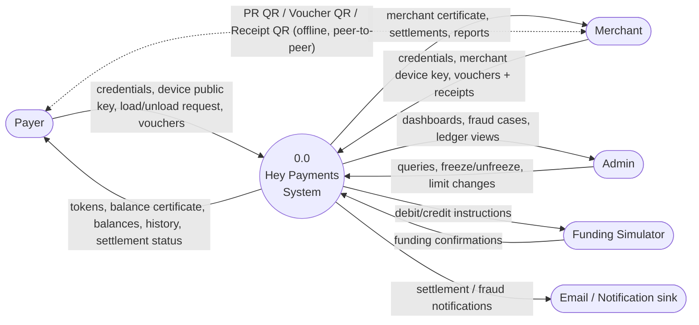
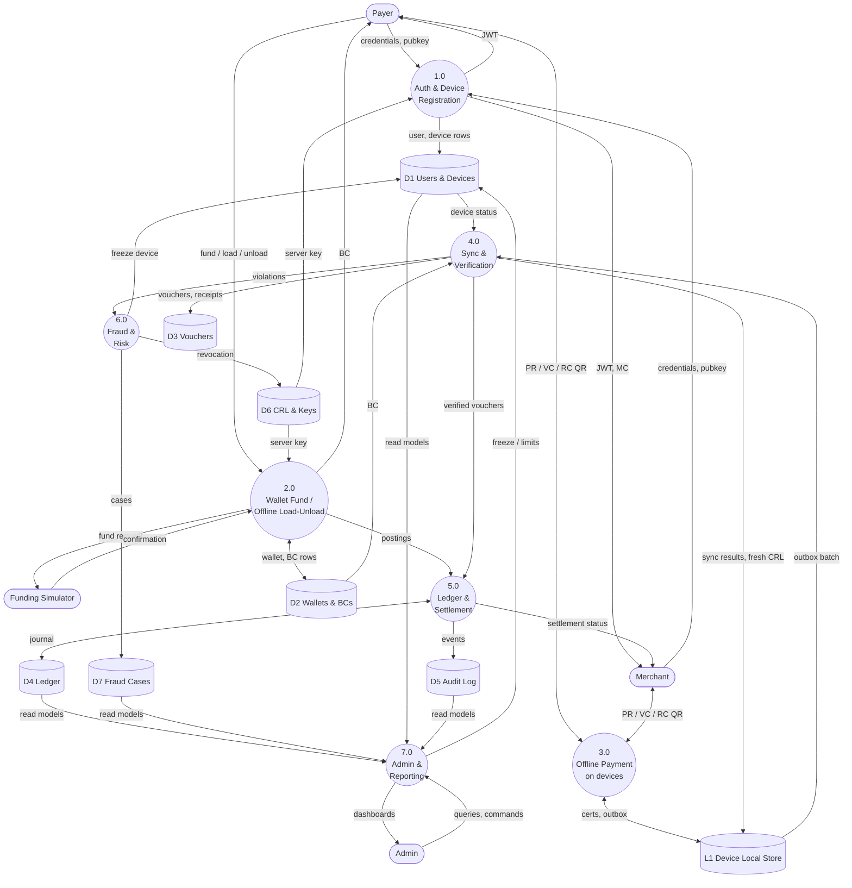
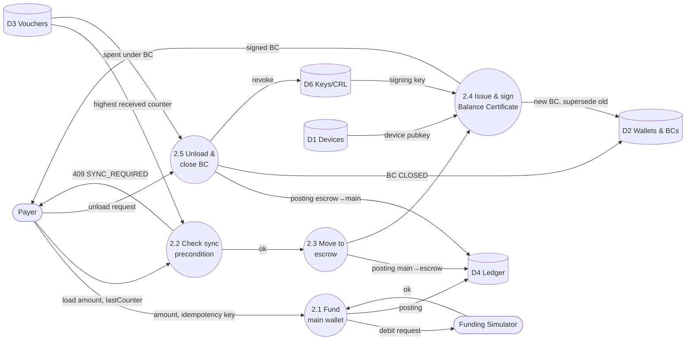
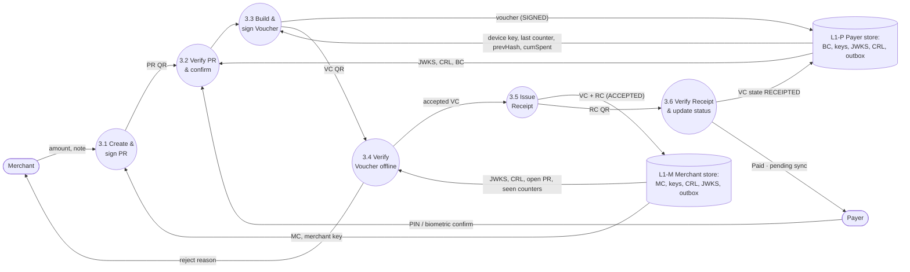
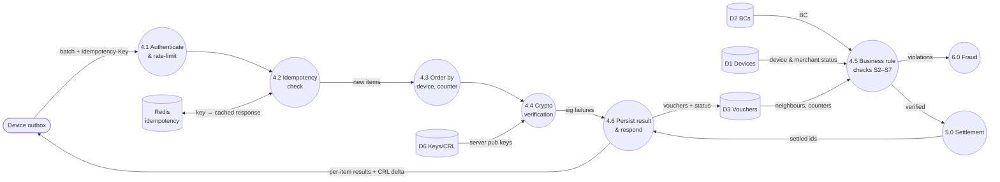

# 04 · Data Flow Diagrams

Notation (Gane–Sarson style, drawn in Mermaid): `([ ])` = external entity, `( )` round = process, `[( )]` = data store, arrows = data flows labelled with the data moved.

## Data stores
| ID | Store | Physical |
|---|---|---|
| D1 | Users & Devices | `users`, `devices`, `merchants`, `refresh_tokens` |
| D2 | Wallets & Certificates | `wallets`, `balance_certificates` |
| D3 | Vouchers & Receipts | `vouchers`, `receipts`, `sync_batches` |
| D4 | Ledger | `ledger_accounts`, `journal_entries`, `journal_lines` |
| D5 | Audit Log | `audit_log` |
| D6 | Revocation List & Server Keys | `devices.status`, `server_keys` |
| D7 | Fraud Cases | `fraud_cases` |
| L1 | Device Local Store (client) | IndexedDB: `keys`, `certs`, `outbox`, `history`, `crl`, `jwks` |

## Level 0: Context diagram

## Level 1: Major processes

## Level 2: 2.0 Wallet Fund / Offline Load–Unload

## Level 2: 3.0 Offline Payment (client-side, no server)

## Level 2: 4.0 Sync & Verification

## Level 2: 5.0 Ledger & Settlement (brief)
5.1 Lock BC → 5.2 compute fee → 5.3 escrow sufficiency check (else 5.3a risk-reserve path) → 5.4 write journal entry + lines (`Σ = 0` assertion) → 5.5 mark voucher SETTLED → 5.6 publish `VoucherSettled` event (→ notification, merchant read model) → 5.7 audit.
