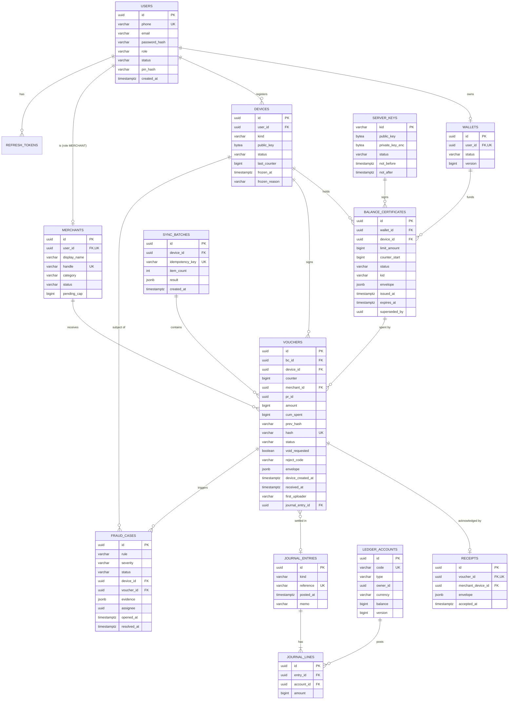

# 05 · Data Model

Conventions: PostgreSQL 16; table names `snake_case` plural; PK `id UUID` (UUIDv7, generated in app); money `BIGINT` paise, **never** `NUMERIC` floats or `double`; timestamps `TIMESTAMPTZ` UTC; `created_at`, `updated_at`, `version BIGINT` (optimistic lock) on mutable tables. Raw signed envelopes are kept verbatim in `JSONB` for evidence.

## ERD


Additional tables: `notifications(id, user_id, type, payload jsonb, read_at)`, `audit_log(id, actor_id, action, entity, entity_id, data jsonb, ip, at)` (append-only; `REVOKE UPDATE, DELETE`), `idempotency_keys(key, user_id, request_hash, response jsonb, status, created_at)` (Redis is primary, table is fallback), `event_publication` (Spring Modulith).

## Enums
| Enum | Values |
|---|---|
| `users.role` | `PAYER`, `MERCHANT`, `ADMIN` |
| `users.status` | `ACTIVE`, `LOCKED`, `DISABLED` |
| `devices.kind` | `PAYER`, `MERCHANT` |
| `devices.status` | `ACTIVE`, `FROZEN`, `REVOKED`, `CLOSED` |
| `balance_certificates.status` | `ACTIVE`, `SUPERSEDED`, `CLOSED`, `EXPIRED` |
| `vouchers.status` | `RECEIVED`, `VERIFIED`, `HELD`, `SETTLED`, `REVERSED`, `REJECTED` |
| `ledger_accounts.type` | `USER_MAIN`, `OFFLINE_ESCROW`, `MERCHANT_PAYABLE`, `PLATFORM_FEES`, `RISK_RESERVE`, `BANK_SIM_CLEARING` |
| `fraud_cases.severity` / `status` | `LOW`, `MEDIUM`, `HIGH` / `OPEN`, `INVESTIGATING`, `RESOLVED_FRAUD`, `RESOLVED_OK` |

## Key constraints and indexes
```sql
-- double-spend guards
CREATE UNIQUE INDEX ux_vouchers_device_counter ON vouchers(device_id, counter);
CREATE UNIQUE INDEX ux_vouchers_hash ON vouchers(hash);
-- one active BC per device
CREATE UNIQUE INDEX ux_bc_active_device ON balance_certificates(device_id) WHERE status = 'ACTIVE';
-- one active payer device per user
CREATE UNIQUE INDEX ux_device_active_user ON devices(user_id, kind) WHERE status = 'ACTIVE';
-- journal idempotency (reference = voucher id / load request id)
CREATE UNIQUE INDEX ux_journal_reference ON journal_entries(reference);
-- amounts
ALTER TABLE vouchers ADD CONSTRAINT ck_amount CHECK (amount > 0 AND cum_spent >= amount);
ALTER TABLE journal_lines ADD CONSTRAINT ck_line_nonzero CHECK (amount <> 0);
CREATE INDEX ix_vouchers_merchant_status ON vouchers(merchant_id, status, received_at DESC);
CREATE INDEX ix_vouchers_bc ON vouchers(bc_id, counter);
```

## Ledger invariants (enforced in code and tested)
1. Every journal entry has ≥ 2 lines and **Σ lines.amount = 0** (checked in `LedgerService.post()`, plus a deferred constraint trigger `trg_journal_balanced`).
2. `ledger_accounts.balance` is updated in the same transaction as the lines (with optimistic locking via `version`). A nightly job recomputes balances from lines and alerts on drift.
3. `USER_MAIN`, `OFFLINE_ESCROW` and `MERCHANT_PAYABLE` must never go negative, **except** `USER_MAIN` during fraud recovery (which sets the user to `LOCKED`).
4. For each BC: `Σ settled vouchers + remaining escrow + reversed = limit`.
5. Global: Σ all account balances = 0.

## Flyway migration plan (`backend/src/main/resources/db/migration`)
| Version | Contents | Phase |
|---|---|---|
| V1__baseline.sql | extensions (`pgcrypto`), `audit_log`, `idempotency_keys`, `event_publication` | 0 |
| V2__auth.sql | `users`, `refresh_tokens` | 1 |
| V3__devices_merchants.sql | `devices`, `merchants`, `server_keys` | 1 |
| V4__ledger.sql | `ledger_accounts`, `journal_entries`, `journal_lines`, balance trigger, system accounts seed | 2 |
| V5__wallets.sql | `wallets` | 2 |
| V6__balance_certificates.sql | `balance_certificates` | 3 |
| V7__vouchers_sync.sql | `vouchers`, `receipts`, `sync_batches` | 6 |
| V8__fraud_notifications.sql | `fraud_cases`, `notifications` | 6 |
| V9__admin_views.sql | reporting views (`v_merchant_daily`, `v_bc_reconciliation`) | 7 |
| R__dev_seed.sql | dev-only seed users (profile `dev`) | 1+ |

Rules: never edit an applied migration; add a new one. Every migration has a matching repository integration test run under Testcontainers.
