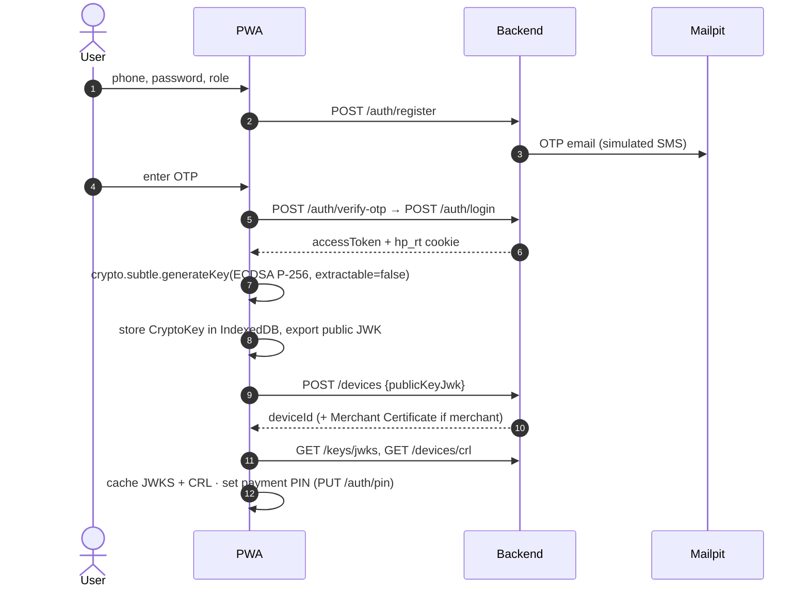
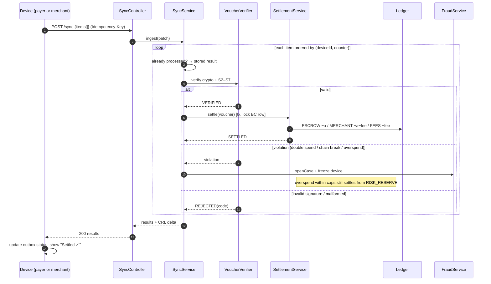
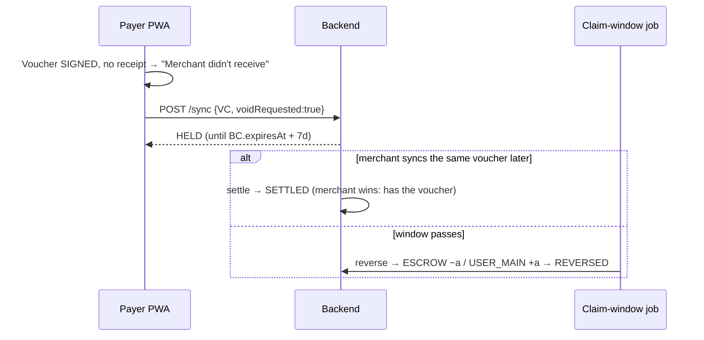
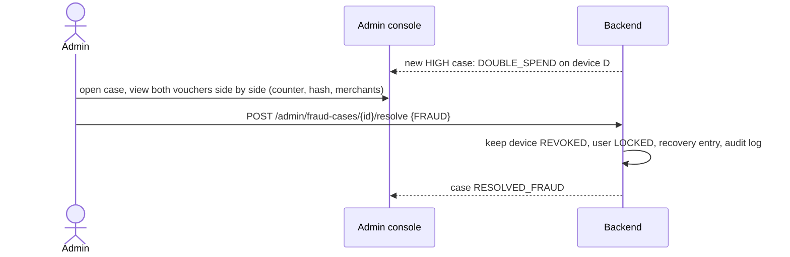
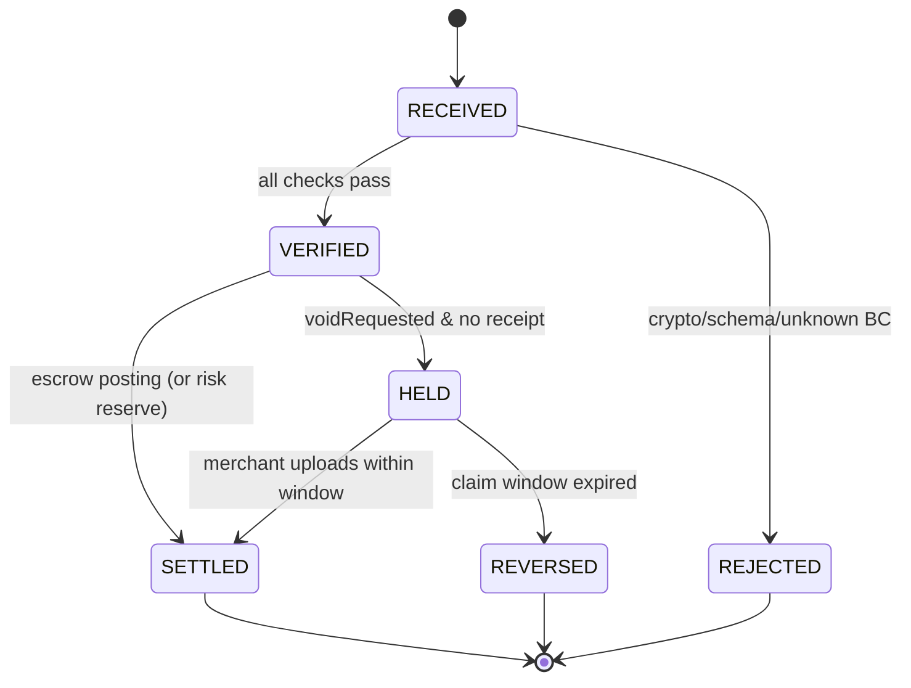
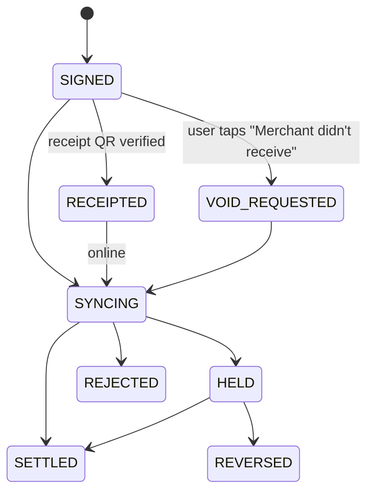
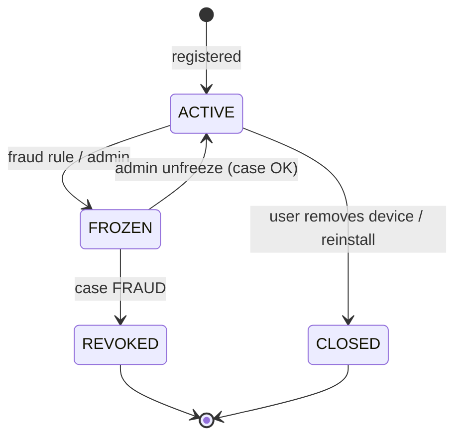
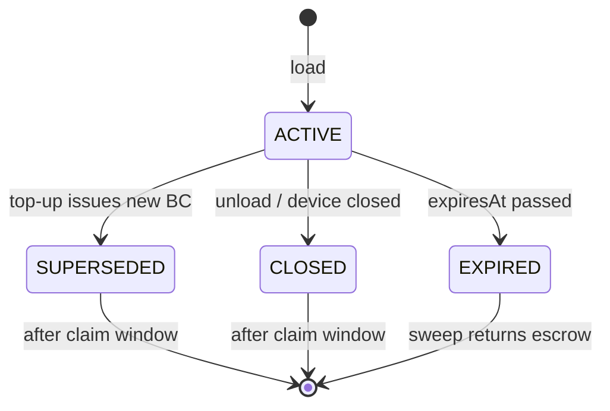

# 07 · Sequence Diagrams and State Machines

## 1. Registration and device binding


## 2. Fund and load offline balance
```mermaid
sequenceDiagram
  autonumber
  participant FE as Payer PWA
  participant API as Backend
  participant L as Ledger
  participant SIM as Funding Simulator
  FE->>API: POST /wallets/me/fund {₹1,000} (Idempotency-Key)
  API->>SIM: debit fake bank
  SIM-->>API: ok
  API->>L: BANK_SIM_CLEARING −1000 / USER_MAIN +1000
  FE->>FE: sync outbox first (if any)
  FE->>API: POST /offline/load {deviceId, ₹500, lastCounter}
  API->>API: check lastCounter == highest received; check caps
  API->>L: USER_MAIN −500 / OFFLINE_ESCROW +500
  API->>API: supersede old BC, sign new BC (server key)
  API-->>FE: BC envelope
  FE->>FE: verify BC sig with JWKS, store, reset spent=0
```

## 3. Offline payment
See [03-offline-protocol.md §4](03-offline-protocol.md#4-the-offline-handshake-happy-path).

## 4. Sync and settlement


## 5. Payer void (merchant never received)


## 6. Dispute / fraud handling (admin)


## 7. State machines
### Voucher (server)


### Voucher (payer device outbox)


### Device


### Balance Certificate


### Payment Request (merchant device)
`OPEN → CONSUMED` (valid voucher scanned) · `OPEN → EXPIRED` (5 min) · `OPEN → CANCELLED` (merchant).
